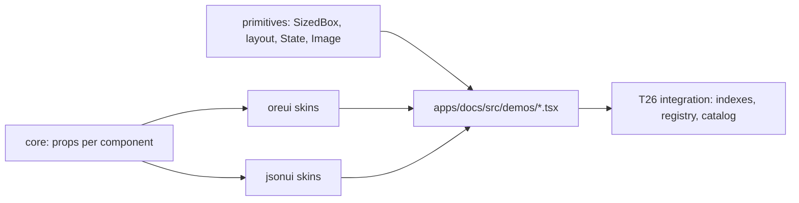
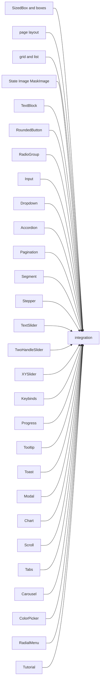

# ore-ui-react catalog: design and plan

**Goal:** Implement the rest of the Gameface UI catalog in both skins where a browser and Gameface can both render it, plus `SizedBox`, the size-capped box SkyGear uses for every window.
**Architecture:** New skin-free package `@ore-ui-react/primitives` (layout boxes, SizedBox, State, Image). Skinned components follow the foundation pattern: props in `@ore-ui-react/core`, markup and CSS in `@ore-ui-react/oreui` and `@ore-ui-react/jsonui`. Each task also writes its docs demo file. One integration task wires indexes, the demo registry and the catalog.
**Tech stack:** as `docs/plans/2026-10-29-foundation.md`.
**Spec:** this file, section "Design".
**Detail:** contracts
**Target-min:** 40

## Design

What the user said: implement the other components as far as possible; make a size-limited div a component (SkyGear uses it often).

SkyGear findings (`D:\project\minecraft-bedrock\SkyGear\assets\resourcepack\oreui\hbui\oui-mc.css`, `oui-ddui.js`, `common/ui/oreui.go`): windows are sized in GUI pixels (`gu(n)` = n x 0.2rem, window 326x166), capped by `max-width: 96vw; max-height: 96vh`; screen-sized boxes use vw/vh, never percent (Gameface resolves percent of absolute boxes against body, which is 0 high on iPad); fixed-width panels use `flex-shrink: 0` because Gameface ignores `min-width: 0`; the body gets size classes `mc-w-s` (< 64rem), `mc-w-m` (< 100rem), `mc-w-l` from `innerWidth / rem` because there is no `@media`.

Rulings:
- Ruling: one task per component (or small family), covering core props, both skins and its demo file (because both skins share props and behavior; the docs need both).
- Ruling: skin-free components (Absolute, Block, Bottom, Column, Content, Flex, Grid, GridTile, Layout, Layout3D, List, Relative, Row, Top, Transform, State, Image, MaskImage, SizedBox) live in `@ore-ui-react/primitives`; their demo shows the same element in both panels.
- Ruling: LiveView stays `planned` (it needs the Gameface engine's live view, no browser equivalent). Performance Trackers and Utility Navigation/EventBus are not in the catalog and are out of scope.
- Ruling: Chart ships bar and line charts drawn with boxes and absolutely placed segments (no canvas in Gameface); pie, donut, area and spider stay out of this plan.
- Ruling: Keybinds ships keyboard and mouse binding without gamepad glyphs (Gameface ships those as generated assets).
- Ruling: demo files import components by deep path (`@ore-ui-react/oreui/src/<Name>/<Name>`) so no task waits on the indexes; the `code` strings show the package-entry import.

## Conventions (every task)

- Behavior and props: read Gameface-UI (MIT) at `https://github.com/CoherentLabs/Gameface-UI/tree/master`: docs `docs/src/content/docs/components/<Category>/<file>.mdx` and source `src/components/<Category>/<Name>/`. Reimplement in React + react-facet; never copy code. Value props are `FacetProp<T>`; components are controlled (`onChange`), presses on left-button `mousedown` via `usePress` or the same `useFacetCallback` pattern; never call `facet.get()` in handlers. Drop Solid- or engine-only APIs and list them in the report.
- Look: Ore UI values from `C:\XboxGames\Minecraft for Windows\Content\data\gui\dist\hbui\index-*.css|js`, JSON UI values from `D:\project\minecraft-bedrock\bedrock-samples\resource_pack\ui\*.json` and `textures\ui\*.png` (read pixels only). 1 GUI px = 0.2rem. One values-table comment at the top of each CSS file citing sources; unknowns marked as estimates. Reuse the foundation components (Button, Slider, ...) where Gameface composes them.
- Classes `oui-<name>` / `jui-<name>`; state classes `on`, `off`, `disabled`, `open`, `active`.
- Gameface CSS: rem, flex, absolute positioning; no `@media`, no `calc()` in shorthands, no `min-width: 0`, no percent sizes on absolutely positioned screen boxes; `mousedown`, never `click`.
- Files per task: `packages/core/src/<id>.ts` (props), `packages/oreui/src/<Name>/<Name>.tsx|<id>.css|<Name>.test.tsx`, the same under `packages/jsonui`, and `apps/docs/src/demos/<id>.tsx` with `export default` a `Record<string, Demo>` keyed by catalog id (`Demo` from `apps/docs/src/catalog`). Primitives tasks use `packages/primitives/src/<Name>.tsx|<Name>.test.tsx` and one shared `primitives.css` owned by T1.
- Tests: `@react-facet/dom-fiber-testing-library`; each skin test file covers the named cases in its task. Verify with `sl run_tests --fast <paths>` and `npm run typecheck`.
- Zero code comments except the CSS values table.

## Main diagram

## Task graph

```mermaid
%% schedule
gantt
  title Predicted schedule (mm:ss)
  dateFormat X
  axisFormat %M:%S
  section lane 1
  T8 Input :t8, 0, 172s
  T20 Toast :t20, 172, 166s
  T4 State  Image  MaskImage :t4, 338, 136s
  T26 integration :t26, 500, 184s
  section lane 2
  T9 Dropdown :t9, 0, 172s
  T21 Modal :t21, 172, 166s
  section lane 3
  T15 TwoHandleSlider :t15, 0, 172s
  T24 Tabs :t24, 172, 166s
  section lane 4
  T17 Keybinds :t17, 0, 172s
  T11 Pagination :t11, 172, 164s
  T1 SizedBox and boxes :t1, 336, 145s
  section lane 5
  T22 Chart :t22, 0, 172s
  T12 Segment :t12, 172, 164s
  T2 page layout :t2, 336, 137s
  section lane 6
  T27 ColorPicker :t27, 0, 172s
  T13 Stepper :t13, 172, 164s
  T3 grid and list :t3, 336, 136s
  section lane 7
  T23 Scroll :t23, 0, 169s
  T7 RadioGroup :t7, 169, 166s
  T14 TextSlider :t14, 336, 164s
  section lane 8
  T25 Carousel :t25, 0, 169s
  T10 Accordion :t10, 169, 166s
  T18 Progress :t18, 336, 164s
  section lane 9
  T16 XYSlider :t16, 0, 168s
  T28 RadialMenu :t28, 168, 168s
  T5 TextBlock :t5, 336, 157s
  section lane 10
  T19 Tooltip :t19, 0, 168s
  T29 Tutorial :t29, 168, 168s
  T6 RoundedButton :t6, 336, 157s
```

critical path: T8 → T26 (5.9 min) · peak width 12 · predicted build 11.4 min · predicted total ≈ 14.9 min (target ✓)

## Package primitives

App type: web UI components. Categories: state, protocol.
**Probe entry:** call=@ore-ui-react/primitives.SizedBox

### T1 SizedBox and boxes · Complexity 4 · Est. context 36k
**Owns:** packages/primitives/package.json, packages/primitives/src/SizedBox.tsx, packages/primitives/src/SizedBox.test.tsx, packages/primitives/src/sizeClass.ts, packages/primitives/src/sizeClass.test.ts, packages/primitives/src/Box.tsx, packages/primitives/src/Box.test.tsx, packages/primitives/src/primitives.css, apps/docs/src/demos/sizedbox.tsx, apps/docs/src/demos/boxes.tsx
**Components:** 2
**LOC owned:** 240
**Tests:** fast
**Model:** sonnet
**Produces:** primitives.SizedBox(props: { width?: number | string; height?: number | string; maxWidth?: string; maxHeight?: string; fixed?: boolean; className?: string; style?: object; children?: ReactNode }) -> JSX.Element · primitives.guiSize(n: number | string) -> string · primitives.sizeClassOf(widthRem: number) -> 's' | 'm' | 'l' · primitives.useSizeClass() -> Facet<'s' | 'm' | 'l'> · primitives.Block, Flex, Row, Column
e.g. guiSize(326) -> '65.2rem'
e.g. guiSize('50vw') -> '50vw'
e.g. sizeClassOf(63.9) -> 's'
**Review Focus:** `caps_default`: SizedBox without max props renders `max-width: 96vw; max-height: 96vh`; `fixed_no_shrink`: `fixed` sets `flex-shrink: 0`; `size_class_resize`: a window `resize` updates the facet
**Test code:** guiSize(0) -> '0rem'; sizeClassOf(64) -> 'm', sizeClassOf(100) -> 'l'; SizedBox width 326 height 166 renders `width: 65.2rem; height: 33.2rem`; Row is a flex row, Column a flex column, Flex passes `direction`, `wrap`, `align`, `justify`.
**Steps:** failing tests, FAIL, implement, PASS, typecheck. package.json name `@ore-ui-react/primitives`, same deps as core. Demo ids: `sizedbox`, `block`, `flex`, `row`, `column`.

### T2 page layout · Complexity 3 · Est. context 32k
**Owns:** packages/primitives/src/PageLayout.tsx, packages/primitives/src/PageLayout.test.tsx, packages/primitives/src/Position.tsx, packages/primitives/src/Position.test.tsx, apps/docs/src/demos/pagelayout.tsx
**Components:** 2
**LOC owned:** 180
**Tests:** fast
**Model:** sonnet
**Produces:** primitives.Layout, Top, Content, Bottom, Absolute, Relative, Transform, Layout3D (props per Gameface docs Layout/*.mdx)
**Review Focus:** `absolute_vw`: Absolute inset props accept rem numbers and strings and never default to percent sizes
**Test code:** Layout renders Top, Content, Bottom in a column with Content growing; Absolute with `top={2} left={4}` renders `top: 2rem; left: 4rem`; Transform maps `translate`, `rotate`, `scale` props to one transform string; Layout3D sets `perspective`.
**Steps:** failing tests, FAIL, implement, PASS, typecheck. Demo ids: `layout`, `top`, `content`, `bottom`, `absolute`, `relative`, `transform`, `layout3d`. Styles inline, not in primitives.css (T1 owns it).

### T3 grid and list · Complexity 3 · Est. context 32k
**Owns:** packages/primitives/src/Grid.tsx, packages/primitives/src/Grid.test.tsx, packages/primitives/src/List.tsx, packages/primitives/src/List.test.tsx, apps/docs/src/demos/grid.tsx
**Components:** 2
**LOC owned:** 170
**Tests:** fast
**Model:** sonnet
**Produces:** primitives.Grid, GridTile, List (props per Gameface docs)
**Review Focus:** `grid_no_css_grid`: Grid is built from flex rows with tile widths in rem or percent of the row (Gameface CSS grid support is not assumed)
**Test code:** Grid `cols={3}` with 7 tiles renders 3 rows of 3, 3, 1; GridTile `colSpan={2}` takes two columns; List renders an item marker per child and `ordered` numbers them.
**Steps:** failing tests, FAIL, implement, PASS, typecheck. Demo ids: `grid`, `gridtile`, `list`.

### T4 State, Image, MaskImage · Complexity 3 · Est. context 32k
**Owns:** packages/primitives/src/State.tsx, packages/primitives/src/State.test.tsx, packages/primitives/src/Image.tsx, packages/primitives/src/Image.test.tsx, apps/docs/src/demos/media.tsx
**Components:** 2
**LOC owned:** 170
**Tests:** fast
**Model:** sonnet
**Produces:** primitives.State(props: { value: FacetProp<string>; children: ReactNode }) -> JSX.Element · primitives.Match(props: { name: string; children: ReactNode }) -> JSX.Element · primitives.Image, MaskImage
**Review Focus:** `state_fallback`: a value with no Match renders the `name=""` fallback
**Test code:** State renders only the matching Match and switches when the facet changes; Image renders `src` with `fill`/`contain` sizing; MaskImage sets `mask-image`.
**Steps:** failing tests, FAIL, implement, PASS, typecheck. Demo ids: `state`, `image`, `maskimage`; images in the demo are self-drawn inline SVG data URIs, no game assets.

## Package skins

App type: web UI components. Categories: state, protocol.
**Probe entry:** call=@ore-ui-react/oreui.Button

Every task below owns `packages/core/src/<id>.ts`, `packages/oreui/src/<Name>/`, `packages/jsonui/src/<Name>/` and `apps/docs/src/demos/<id>.tsx` per Conventions, with Components 3, Tests fast, Model sonnet, and the steps: failing tests, FAIL, implement, PASS, typecheck. Each skin test file covers the named cases.

### T5 TextBlock · Complexity 2 · Est. context 30k
**Owns:** packages/core/src/textblock.ts, packages/oreui/src/TextBlock/TextBlock.tsx, packages/oreui/src/TextBlock/textblock.css, packages/oreui/src/TextBlock/TextBlock.test.tsx, packages/jsonui/src/TextBlock/TextBlock.tsx, packages/jsonui/src/TextBlock/textblock.css, packages/jsonui/src/TextBlock/TextBlock.test.tsx, apps/docs/src/demos/textblock.tsx
**Components:** 3
**LOC owned:** 150
**Tests:** fast
**Model:** sonnet
**Produces:** oreui.TextBlock, oreui.InlineTextBlock, jsonui.TextBlock, jsonui.InlineTextBlock
**Review Focus:** `facet_text`: a `FacetProp<string>` text updates without re-render; `no_html`: text with `<b>` renders literally
**Test code:** TextBlock renders a block, InlineTextBlock an inline span; `variant` title/body/caption sets the class.
**Steps:** see section intro. Demo ids `textblock`, `inlinetextblock`.

### T6 RoundedButton · Complexity 2 · Est. context 30k
**Owns:** packages/core/src/roundedbutton.ts, packages/oreui/src/RoundedButton/RoundedButton.tsx, packages/oreui/src/RoundedButton/roundedbutton.css, packages/oreui/src/RoundedButton/RoundedButton.test.tsx, packages/jsonui/src/RoundedButton/RoundedButton.tsx, packages/jsonui/src/RoundedButton/roundedbutton.css, packages/jsonui/src/RoundedButton/RoundedButton.test.tsx, apps/docs/src/demos/roundedbutton.tsx
**Components:** 3
**LOC owned:** 150
**Tests:** fast
**Model:** sonnet
**Produces:** oreui.RoundedButton, jsonui.RoundedButton
**Review Focus:** `disabled_facet_flip`; `right_click_ignored`
**Test code:** press calls onPress once; disabled ignores; `size` small/medium/large sets the class.
**Steps:** see section intro. Demo id `roundedbutton`.

### T7 RadioGroup · Complexity 3 · Est. context 34k
**Owns:** packages/core/src/radiogroup.ts, packages/oreui/src/RadioGroup/RadioGroup.tsx, packages/oreui/src/RadioGroup/radiogroup.css, packages/oreui/src/RadioGroup/RadioGroup.test.tsx, packages/jsonui/src/RadioGroup/RadioGroup.tsx, packages/jsonui/src/RadioGroup/radiogroup.css, packages/jsonui/src/RadioGroup/RadioGroup.test.tsx, apps/docs/src/demos/radiogroup.tsx
**Components:** 3
**LOC owned:** 220
**Tests:** fast
**Model:** sonnet
**Produces:** oreui.RadioGroup, oreui.Radio, jsonui.RadioGroup, jsonui.Radio
**Review Focus:** `controlled`: pressing an option calls onChange(value) and the selection waits for the facet; `disabled_option`
**Test code:** the option equal to `value` has class `on`; pressing another calls onChange with its value; a disabled group ignores presses.
**Steps:** see section intro. Demo id `radiogroup`.

### T8 Input · Complexity 4 · Est. context 38k
**Owns:** packages/core/src/input.ts, packages/oreui/src/Input/Input.tsx, packages/oreui/src/Input/input.css, packages/oreui/src/Input/Input.test.tsx, packages/jsonui/src/Input/Input.tsx, packages/jsonui/src/Input/input.css, packages/jsonui/src/Input/Input.test.tsx, apps/docs/src/demos/input.tsx
**Components:** 3
**LOC owned:** 260
**Tests:** fast
**Model:** sonnet
**Produces:** oreui.TextInput, oreui.NumberInput, oreui.PasswordInput and the same in jsonui
**Review Focus:** `number_clamp`: NumberInput typing 500 with max 100 reports 100; `max_length`; `facet_value_sync`: an outside facet change updates the field
**Test code:** typing calls onChange with the text; NumberInput step buttons add and subtract `step`; PasswordInput masks and toggles visibility.
**Steps:** see section intro (Gameface docs text-input, number-input, password-input). Demo id `input`.

### T9 Dropdown · Complexity 4 · Est. context 38k
**Owns:** packages/core/src/dropdown.ts, packages/oreui/src/Dropdown/Dropdown.tsx, packages/oreui/src/Dropdown/dropdown.css, packages/oreui/src/Dropdown/Dropdown.test.tsx, packages/jsonui/src/Dropdown/Dropdown.tsx, packages/jsonui/src/Dropdown/dropdown.css, packages/jsonui/src/Dropdown/Dropdown.test.tsx, apps/docs/src/demos/dropdown.tsx
**Components:** 3
**LOC owned:** 260
**Tests:** fast
**Model:** sonnet
**Produces:** oreui.Dropdown, jsonui.Dropdown (options `{ value: string; label: ReactNode; disabled?: boolean }[]`)
**Review Focus:** `outside_closes`: mousedown outside closes the list; `disabled_option_ignored`; `listener_cleanup` on unmount
**Test code:** press opens (class `open`), choosing calls onChange(value) and closes; the trigger shows the label of `value` or `placeholder`.
**Steps:** see section intro. Demo id `dropdown`.

### T10 Accordion · Complexity 3 · Est. context 34k
**Owns:** packages/core/src/accordion.ts, packages/oreui/src/Accordion/Accordion.tsx, packages/oreui/src/Accordion/accordion.css, packages/oreui/src/Accordion/Accordion.test.tsx, packages/jsonui/src/Accordion/Accordion.tsx, packages/jsonui/src/Accordion/accordion.css, packages/jsonui/src/Accordion/Accordion.test.tsx, apps/docs/src/demos/accordion.tsx
**Components:** 3
**LOC owned:** 220
**Tests:** fast
**Model:** sonnet
**Produces:** oreui.Accordion, oreui.AccordionItem, jsonui.Accordion, jsonui.AccordionItem
**Review Focus:** `multiple_off`: with `multiple` false opening one closes the other; `disabled_item`
**Test code:** pressing a heading toggles its body; `expanded` facet controls which items are open; onChange reports the open ids.
**Steps:** see section intro. Demo id `accordion`.

### T11 Pagination · Complexity 3 · Est. context 32k
**Owns:** packages/core/src/pagination.ts, packages/oreui/src/Pagination/Pagination.tsx, packages/oreui/src/Pagination/pagination.css, packages/oreui/src/Pagination/Pagination.test.tsx, packages/jsonui/src/Pagination/Pagination.tsx, packages/jsonui/src/Pagination/pagination.css, packages/jsonui/src/Pagination/Pagination.test.tsx, apps/docs/src/demos/pagination.tsx
**Components:** 3
**LOC owned:** 200
**Tests:** fast
**Model:** sonnet
**Produces:** oreui.Pagination, jsonui.Pagination · core.pageWindow(page: number, pageCount: number, size: number) -> number[]
e.g. pageWindow(5, 10, 5) -> [3, 4, 5, 6, 7]
e.g. pageWindow(1, 10, 5) -> [1, 2, 3, 4, 5]
**Review Focus:** `bounds`: prev disabled on page 1, next on the last page; `loop` wraps
**Test code:** pageWindow(10, 10, 5) -> [6, 7, 8, 9, 10]; pageWindow(2, 3, 5) -> [1, 2, 3]; pressing a page calls onChange(page).
**Steps:** see section intro. Demo id `pagination`.

### T12 Segment · Complexity 3 · Est. context 32k
**Owns:** packages/core/src/segment.ts, packages/oreui/src/Segment/Segment.tsx, packages/oreui/src/Segment/segment.css, packages/oreui/src/Segment/Segment.test.tsx, packages/jsonui/src/Segment/Segment.tsx, packages/jsonui/src/Segment/segment.css, packages/jsonui/src/Segment/Segment.test.tsx, apps/docs/src/demos/segment.tsx
**Components:** 3
**LOC owned:** 200
**Tests:** fast
**Model:** sonnet
**Produces:** oreui.Segment, oreui.SegmentButton, jsonui.Segment, jsonui.SegmentButton
**Review Focus:** `controlled`; `disabled_button`
**Test code:** the button equal to `value` is `active`; pressing another calls onChange(value).
**Steps:** see section intro. Demo id `segment`.

### T13 Stepper · Complexity 3 · Est. context 32k
**Owns:** packages/core/src/stepper.ts, packages/oreui/src/Stepper/Stepper.tsx, packages/oreui/src/Stepper/stepper.css, packages/oreui/src/Stepper/Stepper.test.tsx, packages/jsonui/src/Stepper/Stepper.tsx, packages/jsonui/src/Stepper/stepper.css, packages/jsonui/src/Stepper/Stepper.test.tsx, apps/docs/src/demos/stepper.tsx
**Components:** 3
**LOC owned:** 200
**Tests:** fast
**Model:** sonnet
**Produces:** oreui.Stepper, jsonui.Stepper (items `{ value: string; label: ReactNode }[]`)
**Review Focus:** `loop`: next on the last item wraps only when `loop`
**Test code:** shows the label of `value`; arrows call onChange with the previous or next value; at the ends without loop the arrow is disabled.
**Steps:** see section intro. Demo id `stepper`.

### T14 TextSlider · Complexity 3 · Est. context 34k
**Owns:** packages/core/src/textslider.ts, packages/oreui/src/TextSlider/TextSlider.tsx, packages/oreui/src/TextSlider/textslider.css, packages/oreui/src/TextSlider/TextSlider.test.tsx, packages/jsonui/src/TextSlider/TextSlider.tsx, packages/jsonui/src/TextSlider/textslider.css, packages/jsonui/src/TextSlider/TextSlider.test.tsx, apps/docs/src/demos/textslider.tsx
**Components:** 3
**LOC owned:** 200
**Tests:** fast
**Model:** sonnet
**Produces:** oreui.TextSlider, jsonui.TextSlider (a Slider over a list of text values)
**Review Focus:** `snap_to_values`: dragging to 60% of 3 values reports the middle value
**Test code:** shows the current text; dragging calls onChange with the nearest value; disabled ignores.
**Steps:** see section intro; reuse the foundation Slider math (`valueFromPointer`). Demo id `textslider`.

### T15 TwoHandleSlider · Complexity 4 · Est. context 38k
**Owns:** packages/core/src/twohandleslider.ts, packages/oreui/src/TwoHandleSlider/TwoHandleSlider.tsx, packages/oreui/src/TwoHandleSlider/twohandleslider.css, packages/oreui/src/TwoHandleSlider/TwoHandleSlider.test.tsx, packages/jsonui/src/TwoHandleSlider/TwoHandleSlider.tsx, packages/jsonui/src/TwoHandleSlider/twohandleslider.css, packages/jsonui/src/TwoHandleSlider/TwoHandleSlider.test.tsx, apps/docs/src/demos/twohandleslider.tsx
**Components:** 3
**LOC owned:** 260
**Tests:** fast
**Model:** sonnet
**Produces:** oreui.TwoHandleSlider, jsonui.TwoHandleSlider (value `FacetProp<[number, number]>`)
**Review Focus:** `no_cross`: the low handle never passes the high one; `nearest_handle`: a track press moves the nearer handle; `mouseup_detaches`
**Test code:** with track {left 100, width 200}, 0-100: pressing at 150 with value [10, 90] moves the low handle -> onChange([25, 90]).
**Steps:** see section intro. Demo id `twohandleslider`.

### T16 XYSlider · Complexity 4 · Est. context 36k
**Owns:** packages/core/src/xyslider.ts, packages/oreui/src/XYSlider/XYSlider.tsx, packages/oreui/src/XYSlider/xyslider.css, packages/oreui/src/XYSlider/XYSlider.test.tsx, packages/jsonui/src/XYSlider/XYSlider.tsx, packages/jsonui/src/XYSlider/xyslider.css, packages/jsonui/src/XYSlider/XYSlider.test.tsx, apps/docs/src/demos/xyslider.tsx
**Components:** 3
**LOC owned:** 230
**Tests:** fast
**Model:** sonnet
**Produces:** oreui.XYSlider, jsonui.XYSlider (value `FacetProp<{ x: number; y: number }>`)
**Review Focus:** `clamp_both_axes`; `mouseup_detaches`
**Test code:** with area {left 0, top 0, width 200, height 100}, 0-100 on both axes: press at (50, 25) -> onChange({ x: 25, y: 25 }).
**Steps:** see section intro. Demo id `xyslider`.

### T17 Keybinds · Complexity 4 · Est. context 38k
**Owns:** packages/core/src/keybinds.ts, packages/oreui/src/Keybinds/Keybinds.tsx, packages/oreui/src/Keybinds/keybinds.css, packages/oreui/src/Keybinds/Keybinds.test.tsx, packages/jsonui/src/Keybinds/Keybinds.tsx, packages/jsonui/src/Keybinds/keybinds.css, packages/jsonui/src/Keybinds/Keybinds.test.tsx, apps/docs/src/demos/keybinds.tsx
**Components:** 3
**LOC owned:** 260
**Tests:** fast
**Model:** sonnet
**Produces:** oreui.Keybinds, oreui.Keybind, jsonui.Keybinds, jsonui.Keybind · core.resolveBinding(bindings: Record<string, string | null>, action: string, key: string, conflict: 'replace' | 'swap' | 'block') -> Record<string, string | null>
e.g. resolveBinding({ jump: 'Space', crouch: 'C' }, 'crouch', 'Space', 'swap') -> { jump: 'C', crouch: 'Space' }
e.g. resolveBinding({ jump: 'Space', crouch: 'C' }, 'crouch', 'Space', 'replace') -> { jump: null, crouch: 'Space' }
**Review Focus:** `escape_cancels` listening; `listener_cleanup`
**Test code:** `block` returns the input unchanged on a conflict; pressing a slot shows the placeholder while listening, the next keydown calls onChange with resolved bindings.
**Steps:** see section intro. Demo id `keybinds`.

## Package feedback and complex

App type: web UI components. Categories: state, protocol.
**Probe entry:** call=@ore-ui-react/oreui.Modal

Same file pattern and steps as the skins section.

### T18 Progress · Complexity 3 · Est. context 32k
**Owns:** packages/core/src/progress.ts, packages/oreui/src/Progress/Progress.tsx, packages/oreui/src/Progress/progress.css, packages/oreui/src/Progress/Progress.test.tsx, packages/jsonui/src/Progress/Progress.tsx, packages/jsonui/src/Progress/progress.css, packages/jsonui/src/Progress/Progress.test.tsx, apps/docs/src/demos/progress.tsx
**Components:** 3
**LOC owned:** 200
**Tests:** fast
**Model:** sonnet
**Produces:** oreui.ProgressBar, oreui.ProgressCircle, jsonui.ProgressBar, jsonui.ProgressCircle
**Review Focus:** `clamp`: progress 150 renders 100%; `facet_update` without re-render
**Test code:** ProgressBar fill width equals the percent; ProgressCircle is drawn from two rotated half-discs (no SVG, no conic-gradient) and its label shows the percent.
**Steps:** see section intro. Demo id `progress`.

### T19 Tooltip · Complexity 4 · Est. context 36k
**Owns:** packages/core/src/tooltip.ts, packages/oreui/src/Tooltip/Tooltip.tsx, packages/oreui/src/Tooltip/tooltip.css, packages/oreui/src/Tooltip/Tooltip.test.tsx, packages/jsonui/src/Tooltip/Tooltip.tsx, packages/jsonui/src/Tooltip/tooltip.css, packages/jsonui/src/Tooltip/Tooltip.test.tsx, apps/docs/src/demos/tooltip.tsx
**Components:** 3
**LOC owned:** 230
**Tests:** fast
**Model:** sonnet
**Produces:** oreui.Tooltip, jsonui.Tooltip · core.placeTooltip(target: Rect, tip: Size, view: Size, side: 'top' | 'bottom' | 'left' | 'right') -> { x: number; y: number; side: string }
e.g. placeTooltip({x:10,y:10,w:20,h:10}, {w:50,h:20}, {w:400,h:300}, 'right') -> { x: 30, y: 5, side: 'right' }
e.g. placeTooltip({x:380,y:10,w:20,h:10}, {w:50,h:20}, {w:400,h:300}, 'right') -> { x: 330, y: 5, side: 'left' }
**Review Focus:** `flip_on_overflow` (SkyGear: left when no room on the right); `clamp_into_view`
**Test code:** hover (mouseenter) shows, mouseleave hides; `open` facet controls it when given.
**Steps:** see section intro. Demo id `tooltip`.

### T20 Toast · Complexity 3 · Est. context 34k
**Owns:** packages/core/src/toast.ts, packages/oreui/src/Toast/Toast.tsx, packages/oreui/src/Toast/toast.css, packages/oreui/src/Toast/Toast.test.tsx, packages/jsonui/src/Toast/Toast.tsx, packages/jsonui/src/Toast/toast.css, packages/jsonui/src/Toast/Toast.test.tsx, apps/docs/src/demos/toast.tsx
**Components:** 3
**LOC owned:** 220
**Tests:** fast
**Model:** sonnet
**Produces:** oreui.ToastHost, jsonui.ToastHost · core.createToasts() -> { items: Facet<Toast[]>; show(t: Omit<Toast, 'id'>): string; dismiss(id: string): void }
e.g. createToasts().show({ text: 'Saved', timeout: 0 }) -> 't1'
**Review Focus:** `timeout_dismisses` (fake timers); `max_visible`
**Test code:** show adds an item; dismiss removes it; the host renders items in `position` corner.
**Steps:** see section intro. Demo id `toast`.

### T21 Modal · Complexity 3 · Est. context 34k
**Owns:** packages/core/src/modal.ts, packages/oreui/src/Modal/Modal.tsx, packages/oreui/src/Modal/modal.css, packages/oreui/src/Modal/Modal.test.tsx, packages/jsonui/src/Modal/Modal.tsx, packages/jsonui/src/Modal/modal.css, packages/jsonui/src/Modal/Modal.test.tsx, apps/docs/src/demos/modal.tsx
**Components:** 3
**LOC owned:** 220
**Tests:** fast
**Model:** sonnet
**Produces:** oreui.Modal, jsonui.Modal (open `FacetProp<boolean>`, onClose, title, children, actions)
**Review Focus:** `overlay_vw`: the overlay uses vw/vh, not percent; `escape_closes`; `inside_press_kept`
**Test code:** closed renders nothing; open renders title and children; overlay mousedown calls onClose; the JSON UI window is a SizedBox-like vanilla dialog frame.
**Steps:** see section intro. Demo id `modal`.

### T22 Chart · Complexity 4 · Est. context 36k
**Owns:** packages/core/src/chart.ts, packages/oreui/src/Chart/Chart.tsx, packages/oreui/src/Chart/chart.css, packages/oreui/src/Chart/Chart.test.tsx, packages/jsonui/src/Chart/Chart.tsx, packages/jsonui/src/Chart/chart.css, packages/jsonui/src/Chart/Chart.test.tsx, apps/docs/src/demos/chart.tsx
**Components:** 3
**LOC owned:** 260
**Tests:** fast
**Model:** sonnet
**Produces:** oreui.BarChart, oreui.LineChart, jsonui.BarChart, jsonui.LineChart · core.segmentBetween(x1: number, y1: number, x2: number, y2: number) -> { left: number; top: number; length: number; angle: number }
e.g. segmentBetween(0, 0, 3, 4) -> { left: 0, top: 0, length: 5, angle: 53.13 }
**Review Focus:** `empty_data`; `negative_values` baseline
**Test code:** BarChart renders one bar per value with height proportional to max; LineChart renders n-1 segments.
**Steps:** see section intro. Demo id `chart`.

### T23 Scroll · Complexity 4 · Est. context 36k
**Owns:** packages/core/src/scroll.ts, packages/oreui/src/Scroll/Scroll.tsx, packages/oreui/src/Scroll/scroll.css, packages/oreui/src/Scroll/Scroll.test.tsx, packages/jsonui/src/Scroll/Scroll.tsx, packages/jsonui/src/Scroll/scroll.css, packages/jsonui/src/Scroll/Scroll.test.tsx, apps/docs/src/demos/scroll.tsx
**Components:** 3
**LOC owned:** 240
**Tests:** fast
**Model:** sonnet
**Produces:** oreui.Scroll, jsonui.Scroll · core.thumbOf(scrollTop: number, viewH: number, contentH: number, trackH: number, minThumb: number) -> { top: number; height: number }
e.g. thumbOf(0, 100, 400, 100, 10) -> { top: 0, height: 25 }
e.g. thumbOf(300, 100, 400, 100, 10) -> { top: 75, height: 25 }
**Review Focus:** `no_overflow_hides_bar`; `drag_thumb`; `end_sticks` (SkyGear `end`: stays at the bottom when content grows)
**Test code:** thumbOf(0, 100, 100, 100, 10) -> { top: 0, height: 100 }; wheel scrolls the content.
**Steps:** see section intro; Gameface draws no scrollbar, so both skins draw their own (JSON UI: ScrollRail/ScrollHandle look from ui_common). Demo id `scroll`.

### T24 Tabs · Complexity 3 · Est. context 34k
**Owns:** packages/core/src/tabs.ts, packages/oreui/src/Tabs/Tabs.tsx, packages/oreui/src/Tabs/tabs.css, packages/oreui/src/Tabs/Tabs.test.tsx, packages/jsonui/src/Tabs/Tabs.tsx, packages/jsonui/src/Tabs/tabs.css, packages/jsonui/src/Tabs/Tabs.test.tsx, apps/docs/src/demos/tabs.tsx
**Components:** 3
**LOC owned:** 220
**Tests:** fast
**Model:** sonnet
**Produces:** oreui.Tabs, oreui.Tab, oreui.TabLink and the same in jsonui
**Review Focus:** `controlled`; `only_active_panel` renders
**Test code:** pressing a TabLink calls onChange(id); the Tab with the active id renders, others do not.
**Steps:** see section intro. Demo ids `tabs`, `tab`, `tablink`.

### T25 Carousel · Complexity 4 · Est. context 36k
**Owns:** packages/core/src/carousel.ts, packages/oreui/src/Carousel/Carousel.tsx, packages/oreui/src/Carousel/carousel.css, packages/oreui/src/Carousel/Carousel.test.tsx, packages/jsonui/src/Carousel/Carousel.tsx, packages/jsonui/src/Carousel/carousel.css, packages/jsonui/src/Carousel/Carousel.test.tsx, apps/docs/src/demos/carousel.tsx
**Components:** 3
**LOC owned:** 240
**Tests:** fast
**Model:** sonnet
**Produces:** oreui.Carousel, jsonui.Carousel
**Review Focus:** `bounds` and `loop`; `items_per_page`
**Test code:** next and prev move by one page; dots show the page count and pressing one calls onChange(page).
**Steps:** see section intro. Demo id `carousel`.

### T27 ColorPicker · Complexity 5 · Est. context 40k
**Owns:** packages/core/src/colorpicker.ts, packages/oreui/src/ColorPicker/ColorPicker.tsx, packages/oreui/src/ColorPicker/colorpicker.css, packages/oreui/src/ColorPicker/ColorPicker.test.tsx, packages/jsonui/src/ColorPicker/ColorPicker.tsx, packages/jsonui/src/ColorPicker/colorpicker.css, packages/jsonui/src/ColorPicker/ColorPicker.test.tsx, apps/docs/src/demos/colorpicker.tsx
**Components:** 3
**LOC owned:** 260
**Tests:** fast
**Model:** sonnet
**Produces:** oreui.ColorPicker, jsonui.ColorPicker · core.hsvToHex(h: number, s: number, v: number) -> string · core.hexToHsv(hex: string) -> { h: number; s: number; v: number }
e.g. hsvToHex(0, 1, 1) -> '#ff0000'
e.g. hexToHsv('#00ff00') -> { h: 120, s: 1, v: 1 }
**Review Focus:** `invalid_hex` keeps the last value; `round_trip`
**Test code:** hsvToHex(240, 1, 0.5) -> '#000080'; the saturation/value area and hue strip report onChange(hex) (reuse XY press math locally, gradients by stacked linear-gradient layers).
**Steps:** see section intro. Demo id `colorpicker`.

### T28 RadialMenu · Complexity 4 · Est. context 36k
**Owns:** packages/core/src/radialmenu.ts, packages/oreui/src/RadialMenu/RadialMenu.tsx, packages/oreui/src/RadialMenu/radialmenu.css, packages/oreui/src/RadialMenu/RadialMenu.test.tsx, packages/jsonui/src/RadialMenu/RadialMenu.tsx, packages/jsonui/src/RadialMenu/radialmenu.css, packages/jsonui/src/RadialMenu/RadialMenu.test.tsx, apps/docs/src/demos/radialmenu.tsx
**Components:** 3
**LOC owned:** 230
**Tests:** fast
**Model:** sonnet
**Produces:** oreui.RadialMenu, jsonui.RadialMenu · core.sectorOf(dx: number, dy: number, count: number) -> number
e.g. sectorOf(0, -10, 4) -> 0
e.g. sectorOf(10, 0, 4) -> 1
**Review Focus:** `dead_zone`: a pointer within the inner radius selects nothing
**Test code:** sectorOf(0, 10, 4) -> 2; items are placed on a circle; pointer move highlights, mousedown calls onChange(index).
**Steps:** see section intro. Demo id `radialmenu`.

### T29 Tutorial · Complexity 4 · Est. context 36k
**Owns:** packages/core/src/tutorial.ts, packages/oreui/src/Tutorial/Tutorial.tsx, packages/oreui/src/Tutorial/tutorial.css, packages/oreui/src/Tutorial/Tutorial.test.tsx, packages/jsonui/src/Tutorial/Tutorial.tsx, packages/jsonui/src/Tutorial/tutorial.css, packages/jsonui/src/Tutorial/Tutorial.test.tsx, apps/docs/src/demos/tutorial.tsx
**Components:** 3
**LOC owned:** 230
**Tests:** fast
**Model:** sonnet
**Produces:** oreui.Tutorial, jsonui.Tutorial (steps `{ target: string; title: ReactNode; content: ReactNode }[]`, `step` facet)
**Review Focus:** `missing_target` shows the step centered; `last_step_finish`
**Test code:** the highlight box matches the target element rect; next and back call onChange(step +- 1); finish calls onFinish.
**Steps:** see section intro. Demo id `tutorial`.

## Package integration

App type: web UI. Categories: protocol.
**Probe entry:** run=npm run build:docs

### T26 integration · Complexity 4 · Est. context 50k
**Owns:** packages/core/src/index.ts, packages/oreui/src/index.ts, packages/jsonui/src/index.ts, packages/primitives/src/index.ts, apps/docs/src/catalog.ts, apps/docs/src/catalog.test.ts, apps/docs/src/App.tsx, apps/docs/src/App.test.tsx, apps/docs/src/demos/index.ts, apps/docs/src/demos.test.tsx, apps/docs/src/main.tsx, README.md
**Components:** 2
**LOC owned:** 260
**Tests:** slow
**Model:** sonnet
**Consumes:** every Produces line above
**Produces:** docs.DEMOS: Record<string, Demo> merging `apps/docs/src/demos.tsx` and every `apps/docs/src/demos/*.tsx` default export
**Review Focus:** `ready_has_demo`: an entry is ready exactly when DEMOS has its id (status derived, no hard-coded list); `sizedbox_listed`: the catalog lists SizedBox under a new "Minecraft" category with no Gameface source link
**Test code:** every DEMOS entry renders both skins; `npm run build:docs` exits 0; `liveview` stays planned.
**Steps:** export everything from the indexes; switch demo files from deep imports to package entries; derive readiness from DEMOS; README component list and SizedBox usage; run tests, typecheck, build.

## Self-review

Coverage: every catalog entry but LiveView has a task; SizedBox is T1. Parallel tasks share no files; indexes and catalog belong only to T26.
