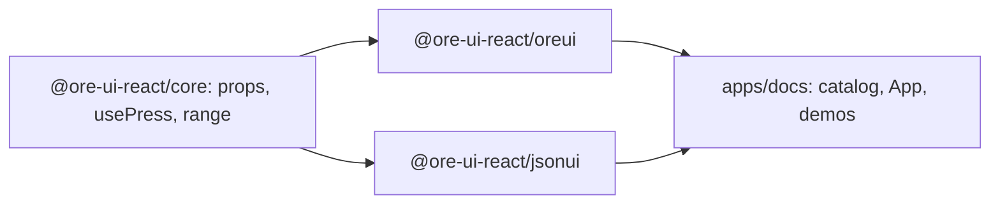
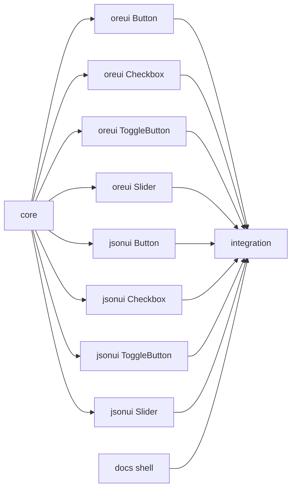

# ore-ui-react foundation: design and plan

**Goal:** A react-facet component library with two skins (Mojang Ore UI look, vanilla JSON UI look) and a Vite docs app that walks the Gameface UI component catalog. This plan ships the foundation and the first four components.
**Architecture:** npm workspaces. `@ore-ui-react/core` holds the shared prop contracts and behavior hooks; `@ore-ui-react/oreui` and `@ore-ui-react/jsonui` render the same props with different markup and CSS; `apps/docs` renders both skins side by side.
**Tech stack:** TypeScript 5.6, React 18.3.1, @react-facet/core and @react-facet/dom-fiber 18.6.0, @react-facet/dom-fiber-testing-library 18.6.0, Vitest + jsdom, Vite.
**Spec:** this file, section "Design".
**Detail:** contracts
**Target-min:** 14

## Design

What the user said: build `PresentKim/ore-ui-react`; manage Ore UI style and vanilla JSON UI style components; reference other projects only within what their licenses allow; Mojang `ore-ui` (react-facet, MIT) is the base; Gameface docs describe the engine; provide a demo and docs page that draws the Gameface UI components (https://gameface-ui.coherent-labs.com/components/) in Ore UI style. Answers: react-facet only; only CSS or self-made assets in the repo; Vite custom docs app; AI orchestrator.

Assumptions and rulings:
- Ruling: first scope is the foundation plus Button, Checkbox, ToggleButton, Slider (because the full catalog is about 50 components; the rest follow in later plans with the same pattern).
- Ruling: npm workspaces, not pnpm (because pnpm is not installed).
- Ruling: value props are `FacetProp<T>` and markup uses dom-fiber `fast-*` elements (react-facet idiom, as in the existing in-game Switch sample).
- Ruling: Gameface-UI (MIT, SolidJS) is a reference for component names and behavior only; no code is copied. Component names follow it (`ToggleButton`, not `Switch`).
- Ruling: Ore UI values (sizes, colors, timings) are read from the installed game's `C:\XboxGames\Minecraft for Windows\Content\data\gui\dist\hbui\index-*.css` and `index-*.js`; JSON UI values from `D:\project\minecraft-bedrock\bedrock-samples\resource_pack\textures\ui\*.png` and `resource_pack\ui\*.json`. Only measured values go into our CSS; no PNG, font or bundle code is copied. Where a value cannot be found, the component file's CSS states it as an estimate in the docs page, never as fact.
- Ruling: no Minecraft font is shipped; skins use `font-family: var(--oui-font, sans-serif)`.
- Ruling: packages ship TypeScript source (`main: src/index.ts`); no npm publish build or push in this plan (outward actions are deferred to the user).
- Ruling: docs and code in English (public library).
- Ruling: Gameface links point to `https://github.com/CoherentLabs/Gameface-UI/tree/main/src/components/<Category>/<Name>` (path verified via the GitHub API on 2026-10-29).

Units:
- core: prop types (one per component, shared by both skins), `usePress` (left-button mousedown, honours a disabled facet; Gameface sends no `click` to divs), range math for sliders.
- oreui / jsonui: one folder per component (`Button/Button.tsx`, `Button/button.css`, `Button/Button.test.tsx`). Class prefix `oui-` and `jui-`.
- docs: `catalog.ts` lists every Gameface UI component by category with status `ready` or `planned`; `App` shows a sidebar and, for ready entries, both skins plus a code sample; `demos.tsx` registers demos.

Error handling: components are controlled; they never set their own value, they report through `onChange`/`onPress`. Disabled or non-left presses are ignored. Range math clamps and never divides by zero.

Testing: Vitest in jsdom with `@react-facet/dom-fiber-testing-library` `render` and `fireEvent`. Docs build is the slow check.

## Global constraints

- Root `package.json`: `"private": true`, `"type": "module"`, workspaces `["packages/*", "apps/*"]`, scripts `test` = `vitest run`, `typecheck` = `tsc -p tsconfig.json`, `dev` = `npm run dev -w @ore-ui-react/docs`, `build:docs` = `npm run build -w @ore-ui-react/docs`.
- Workspace names: `@ore-ui-react/core`, `@ore-ui-react/oreui`, `@ore-ui-react/jsonui`, `@ore-ui-react/docs`. Each package `main` and `types` = `src/index.ts`; skins depend on `@ore-ui-react/core` via `"*"`.
- One root `tsconfig.json`: target es2017, module esnext, moduleResolution bundler, jsx react-jsx, strict, noEmit, lib dom+es2017, `"types": []`, skipLibCheck, include `packages/*/src`, `apps/docs/src`, `test`.
- Test command: `npx vitest run <paths>`; typecheck `npm run typecheck`. Tests live next to sources as `*.test.ts(x)`.
- Gameface-safe CSS: rem units; flex and absolute positioning; no `@media`, no `calc()` inside shorthand properties, no `min-width: 0`; interaction on `mousedown`, never `click`.
- Zero code comments except external constraints (vendor quirks with a source).
- If `node_modules/.bin/vitest` is missing when a task starts, T0 is still installing: wait for it, do not run `npm install` yourself.

## Main diagram

## File structure

- `package.json`, `tsconfig.json`, `vitest.config.ts`, `.gitignore`, `LICENSE`, `test/smoke.test.ts`: workspace skeleton (T0)
- `packages/core/src/props.ts|press.ts|range.ts|index.ts`: contracts and behavior (T1)
- `packages/oreui/src/<Name>/`, `packages/jsonui/src/<Name>/`: one component each (T2-T9)
- `packages/oreui/src/index.ts`, `packages/jsonui/src/index.ts`: skin exports (T11)
- `apps/docs/index.html|vite.config.ts|src/App.tsx|src/catalog.ts|src/docs.css`: docs shell (T10)
- `apps/docs/src/demos.tsx|main.tsx`, `README.md`, `NOTICE.md`: integration (T11)

## Task graph

Ruling: edges T1 -> T2..T9 stay (because component tests execute the real `usePress` hook; a fake hook would test nothing).

## Wave 0

### T0 workspace skeleton · Complexity 1 · Est. context 25k
**Owns:** package.json, package-lock.json, tsconfig.json, vitest.config.ts, .gitignore, LICENSE, test/smoke.test.ts, packages/core/package.json, packages/oreui/package.json, packages/jsonui/package.json, apps/docs/package.json
**Components:** 1
**LOC owned:** 90
**Tests:** fast
**Kind:** mechanical
**Model:** haiku
**Produces:** workspace skeleton per Global constraints
**Test code:** `test/smoke.test.ts` `it('runs')`: `expect(1 + 1).toBe(2)`. Then `npm install` succeeds and `npx vitest run test` passes.
**Steps:** write files from Global constraints; root devDependencies `typescript@^5.6.3`, `vitest`, `jsdom`, `vite`, `@types/react@^18.3.12`, `@react-facet/dom-fiber-testing-library@18.6.0`; core/oreui/jsonui/docs dependencies `react@^18.3.1`, `@react-facet/core@18.6.0`, `@react-facet/dom-fiber@18.6.0`; docs scripts `dev` = `vite`, `build` = `vite build`; `vitest.config.ts` environment `jsdom`, include `["packages/**/*.test.{ts,tsx}", "apps/**/*.test.{ts,tsx}", "test/**/*.test.ts"]`; `.gitignore` `node_modules`, `dist`; `LICENSE` MIT, `Copyright (c) 2026 PresentKim`; run `npm install`.

## Package core

App type: library. Categories: numeric, state.
**Probe entry:** call=@ore-ui-react/core.snapToStep

### T1 core contracts and behavior · Complexity 4 · Est. context 32k
**Owns:** packages/core/src/props.ts, packages/core/src/press.ts, packages/core/src/range.ts, packages/core/src/index.ts, packages/core/src/press.test.tsx, packages/core/src/range.test.ts
**Components:** 2
**LOC owned:** 140
**Tests:** fast
**Model:** sonnet
**Produces:** core.ButtonProps = { children?: ReactNode; variant?: 'primary' | 'secondary' | 'danger'; disabled?: FacetProp<boolean>; onPress?: () => void } · core.CheckboxProps = { checked: FacetProp<boolean>; label?: ReactNode; disabled?: FacetProp<boolean>; onChange?: (checked: boolean) => void } · core.ToggleButtonProps = { value: FacetProp<boolean>; disabled?: FacetProp<boolean>; onChange?: (on: boolean) => void } · core.SliderProps = { value: FacetProp<number>; min?: number; max?: number; step?: number; disabled?: FacetProp<boolean>; onChange?: (value: number) => void } · core.usePress(onPress?: () => void, disabled?: FacetProp<boolean>) -> (event: MouseEvent) => void · core.snapToStep(value: number, min: number, max: number, step: number) -> number · core.ratioOf(value: number, min: number, max: number) -> number · core.valueFromPointer(x: number, left: number, width: number, min: number, max: number, step: number) -> number
e.g. snapToStep(47, 0, 100, 10) -> 50
e.g. ratioOf(25, 0, 100) -> 0.25
e.g. valueFromPointer(150, 100, 200, 0, 100, 1) -> 25
**Review Focus:** `snap_zero_step`: snapToStep(5, 0, 10, 0) -> 5; `snap_float`: snapToStep(0.1 + 0.2, 0, 1, 0.1) -> 0.3 (toBe); `pointer_zero_width`: valueFromPointer(10, 0, 0, 0, 100, 1) -> 0; `press_disabled_facet_flip`: press works, then `disabled.set(true)`, next press does not call onPress
**Test code:** range: `snapToStep(-5, 0, 100, 1)` -> 0; `snapToStep(0.3, 0, 1, 0.25)` -> 0.25; `ratioOf(150, 0, 100)` -> 1; `ratioOf(5, 5, 5)` -> 0; `valueFromPointer(50, 100, 200, 0, 100, 1)` -> 0; `valueFromPointer(400, 100, 200, 0, 100, 1)` -> 100. press (render a `fast-div` with `onMouseDown={usePress(spy, disabled)}`): `mouseDown` button 0 calls spy once; button 2 does not; `disabled` true does not; the flip case above.
**Steps:** failing tests, run FAIL, implement, run PASS, `npm run typecheck`.
**Notes:** `snapToStep` rounds to the step's decimal places to kill float noise. `usePress` reads `disabled` at call time (`useFacetCallback` over `useFacetWrap(disabled ?? false)`).

## Package oreui

App type: web UI components. Categories: state, protocol (mouse events).
**Probe entry:** call=@ore-ui-react/oreui.Button

Shared for T2-T9: consume the matching props type and `usePress`; read look values from the sources named in the Design rulings and list them in a values table at the top of the component's CSS file as one comment block citing the source file (an external-constraint comment). Tests use `render` and `fireEvent` from `@react-facet/dom-fiber-testing-library` and query by class.

### T2 oreui Button · Complexity 3 · Est. context 34k
**Owns:** packages/oreui/src/Button/Button.tsx, packages/oreui/src/Button/button.css, packages/oreui/src/Button/Button.test.tsx
**Components:** 1
**LOC owned:** 130
**Tests:** fast
**Model:** sonnet
**Consumes:** core.ButtonProps (T1) · core.usePress(onPress?: () => void, disabled?: FacetProp<boolean>) -> (event: MouseEvent) => void (T1)
**Produces:** oreui.Button(props: ButtonProps) -> JSX.Element
**Review Focus:** `disabled_facet_flip`: class `disabled` appears after `disabled.set(true)` and press is ignored; `right_click_ignored`
**Test code:** renders children text; root has class `oui-button oui-button-secondary` by default and `oui-button-primary` for `variant="primary"`; mouseDown calls onPress once; disabled true ignores it.
**Steps:** failing tests, FAIL, implement, PASS, typecheck.
**Notes:** Ore UI vanilla button: face, bottom shadow, hover and pressed states from `index-*.css`.

### T3 oreui Checkbox · Complexity 3 · Est. context 34k
**Owns:** packages/oreui/src/Checkbox/Checkbox.tsx, packages/oreui/src/Checkbox/checkbox.css, packages/oreui/src/Checkbox/Checkbox.test.tsx
**Components:** 1
**LOC owned:** 130
**Tests:** fast
**Model:** sonnet
**Consumes:** core.CheckboxProps (T1) · core.usePress(onPress?: () => void, disabled?: FacetProp<boolean>) -> (event: MouseEvent) => void (T1)
**Produces:** oreui.Checkbox(props: CheckboxProps) -> JSX.Element
**Review Focus:** `controlled`: press with checked false calls onChange(true) and the box keeps class `off` until the facet is set; `disabled_facet_flip`
**Test code:** class `on` when checked true, `off` when false; label text rendered; mouseDown calls onChange(!checked); disabled ignores.
**Steps:** failing tests, FAIL, implement, PASS, typecheck.

### T4 oreui ToggleButton · Complexity 4 · Est. context 40k
**Owns:** packages/oreui/src/ToggleButton/ToggleButton.tsx, packages/oreui/src/ToggleButton/toggle-button.css, packages/oreui/src/ToggleButton/ToggleButton.test.tsx
**Components:** 1
**LOC owned:** 290
**Tests:** fast
**Model:** sonnet
**Consumes:** core.ToggleButtonProps (T1) · core.usePress(onPress?: () => void, disabled?: FacetProp<boolean>) -> (event: MouseEvent) => void (T1)
**Produces:** oreui.ToggleButton(props: ToggleButtonProps) -> JSX.Element
**Review Focus:** `controlled`; `slide_only_on_press`: thumb gets `to-on` after a press, plain `on` after an outside `value.set(true)`
**Test code:** thumb class `on`/`off` follows value; press calls onChange(!value); disabled ignores; animationend clears `to-on`.
**Steps:** port `D:\project\minecraft-bedrock\bedrock-json-ui-research\ore-ui-loading\samples\oui-react\src\Switch.tsx` and `switch.css` (same author) to the new props, `oui-toggle-button` prefix, `disabled` as a facet; failing tests, FAIL, implement, PASS, typecheck.

### T5 oreui Slider · Complexity 5 · Est. context 42k
**Owns:** packages/oreui/src/Slider/Slider.tsx, packages/oreui/src/Slider/slider.css, packages/oreui/src/Slider/Slider.test.tsx
**Components:** 1
**LOC owned:** 180
**Tests:** fast
**Model:** sonnet
**Consumes:** core.SliderProps (T1) · core.valueFromPointer(x: number, left: number, width: number, min: number, max: number, step: number) -> number (T1) · core.ratioOf(value: number, min: number, max: number) -> number (T1)
**Produces:** oreui.Slider(props: SliderProps) -> JSX.Element
**Review Focus:** `drag_clamps`: move past the track end gives onChange(max); `mouseup_detaches`: no onChange after document mouseup; `disabled_facet_flip`
**Test code:** with track rect mocked `{left: 100, width: 200}` and min 0 max 100: mouseDown at clientX 150 -> onChange(25); document mouseMove 250 -> onChange(75); fill width style follows `ratioOf(value)` as percent.
**Steps:** failing tests, FAIL, implement, PASS, typecheck.

## Package jsonui

App type: web UI components. Categories: state, protocol.
**Probe entry:** call=@ore-ui-react/jsonui.Button

### T6 jsonui Button · Complexity 3 · Est. context 34k
**Owns:** packages/jsonui/src/Button/Button.tsx, packages/jsonui/src/Button/button.css, packages/jsonui/src/Button/Button.test.tsx
**Components:** 1
**LOC owned:** 130
**Tests:** fast
**Model:** sonnet
**Consumes:** core.ButtonProps (T1) · core.usePress(onPress?: () => void, disabled?: FacetProp<boolean>) -> (event: MouseEvent) => void (T1)
**Produces:** jsonui.Button(props: ButtonProps) -> JSX.Element
**Review Focus:** `disabled_facet_flip`; `right_click_ignored`
**Test code:** same cases as T2 with prefix `jui-button`.
**Steps:** failing tests, FAIL, implement, PASS, typecheck.
**Notes:** look from `button_borderless_light*.png` and the classic button textures (nine-slice drawn with borders).

### T7 jsonui Checkbox · Complexity 3 · Est. context 34k
**Owns:** packages/jsonui/src/Checkbox/Checkbox.tsx, packages/jsonui/src/Checkbox/checkbox.css, packages/jsonui/src/Checkbox/Checkbox.test.tsx
**Components:** 1
**LOC owned:** 130
**Tests:** fast
**Model:** sonnet
**Consumes:** core.CheckboxProps (T1) · core.usePress(onPress?: () => void, disabled?: FacetProp<boolean>) -> (event: MouseEvent) => void (T1)
**Produces:** jsonui.Checkbox(props: CheckboxProps) -> JSX.Element
**Review Focus:** `controlled`; `disabled_facet_flip`
**Test code:** same cases as T3 with prefix `jui-checkbox`.
**Steps:** failing tests, FAIL, implement, PASS, typecheck.

### T8 jsonui ToggleButton · Complexity 3 · Est. context 34k
**Owns:** packages/jsonui/src/ToggleButton/ToggleButton.tsx, packages/jsonui/src/ToggleButton/toggle-button.css, packages/jsonui/src/ToggleButton/ToggleButton.test.tsx
**Components:** 1
**LOC owned:** 140
**Tests:** fast
**Model:** sonnet
**Consumes:** core.ToggleButtonProps (T1) · core.usePress(onPress?: () => void, disabled?: FacetProp<boolean>) -> (event: MouseEvent) => void (T1)
**Produces:** jsonui.ToggleButton(props: ToggleButtonProps) -> JSX.Element
**Review Focus:** `controlled`; `disabled_facet_flip`
**Test code:** class `on`/`off` follows value; press calls onChange(!value); disabled ignores.
**Steps:** failing tests, FAIL, implement, PASS, typecheck.
**Notes:** look from the vanilla `toggle_*` textures and `ui/ui_common.json` toggle definitions.

### T9 jsonui Slider · Complexity 5 · Est. context 42k
**Owns:** packages/jsonui/src/Slider/Slider.tsx, packages/jsonui/src/Slider/slider.css, packages/jsonui/src/Slider/Slider.test.tsx
**Components:** 1
**LOC owned:** 180
**Tests:** fast
**Model:** sonnet
**Consumes:** core.SliderProps (T1) · core.valueFromPointer(x: number, left: number, width: number, min: number, max: number, step: number) -> number (T1) · core.ratioOf(value: number, min: number, max: number) -> number (T1)
**Produces:** jsonui.Slider(props: SliderProps) -> JSX.Element
**Review Focus:** `drag_clamps`; `mouseup_detaches`; `disabled_facet_flip`
**Test code:** same cases as T5 with prefix `jui-slider`.
**Steps:** failing tests, FAIL, implement, PASS, typecheck.

## Package docs

App type: web UI. Categories: encoding (rendering), protocol (hash routing).
**Probe entry:** call=docs.App

### T10 docs shell · Complexity 4 · Est. context 38k
**Owns:** apps/docs/index.html, apps/docs/vite.config.ts, apps/docs/src/catalog.ts, apps/docs/src/App.tsx, apps/docs/src/docs.css, apps/docs/src/catalog.test.ts, apps/docs/src/App.test.tsx
**Components:** 2
**LOC owned:** 260
**Tests:** fast
**Model:** sonnet
**Produces:** docs.CATALOG: CatalogCategory[] where CatalogCategory = { id: string; title: string; entries: CatalogEntry[] } and CatalogEntry = { id: string; name: string; source: string; status: 'ready' | 'planned' } · docs.Demo = { oreui: () => ReactElement; jsonui: () => ReactElement; code: string } · docs.App(props: { catalog: CatalogCategory[]; demos: Record<string, Demo> }) -> JSX.Element
e.g. CATALOG[0] -> { id: 'basic', title: 'Basic', entries: [{ id: 'accordion', name: 'Accordion', source: 'https://github.com/CoherentLabs/Gameface-UI/tree/main/src/components/Basic/Accordion', status: 'planned' }, ...] }
**Review Focus:** `code_as_text`: a demo code string `<Button>` renders literally; `unknown_hash`: `#/nope` shows the catalog index, no throw
**Test code:** CATALOG has categories basic, complex, feedback, layout, media in that order with the Gameface entry names (Basic: Accordion Button Checkbox Dropdown InlineTextBlock Input Keybinds Pagination RadioGroup RoundedButton Segment Slider State Stepper TextBlock TextSlider ToggleButton TwoHandleSlider XYSlider; Complex: Carousel ColorPicker RadialMenu Tutorial; Feedback: Chart Modal Progress Toast Tooltip; Layout: Absolute Block Bottom Column Content Flex Grid GridTile Layout Layout3D List Relative Row Scroll Tab TabLink Tabs Top Transform; Media: Image LiveView MaskImage); exactly button, checkbox, slider, togglebutton are `ready`. App with a fake demo: `#/basic/button` shows both panels titled `Ore UI` and `JSON UI` and the code; a planned entry shows `Planned` and its source link.
**Steps:** failing tests, FAIL, implement, PASS, typecheck.
**Notes:** route from `location.hash` `#/<category>/<entry>`, update on `hashchange`.

## Package integration

App type: web UI. Categories: protocol.
**Probe entry:** run=npm run build:docs

### T11 skin exports, demos, readme · Complexity 4 · Est. context 45k
**Owns:** packages/oreui/src/index.ts, packages/jsonui/src/index.ts, apps/docs/src/demos.tsx, apps/docs/src/main.tsx, apps/docs/src/demos.test.tsx, README.md, NOTICE.md
**Components:** 2
**LOC owned:** 220
**Tests:** slow
**Model:** sonnet
**Consumes:** oreui.Button, oreui.Checkbox, oreui.ToggleButton, oreui.Slider (T2-T5) · jsonui.Button, jsonui.Checkbox, jsonui.ToggleButton, jsonui.Slider (T6-T9) · docs.CATALOG, docs.App, docs.Demo (T10)
**Produces:** docs.DEMOS: Record<string, Demo>
**Review Focus:** `ready_has_demo`: every `ready` entry id has a DEMOS key and vice versa
**Test code:** each DEMOS entry renders oreui and jsonui without throwing and with a facet that changes on press; `npm run build:docs` exits 0.
**Steps:** skin `index.ts` exports components and re-exports props types; demos own their facets (`createFacet`) so they are interactive; `main.tsx` mounts `App` with `createRoot` from dom-fiber; README (install, usage, both skins, docs dev command), NOTICE (MIT references: Mojang ore-ui, Coherent Labs Gameface-UI; "Not an official Minecraft product. Not approved by or associated with Mojang or Microsoft."); run tests and build.

## Self-review

Coverage: two skins (T2-T9), react-facet only (T1 props, all components), CSS-only assets (constraints), Vite docs with the Gameface catalog (T10, T11). No placeholders. Consumes match Produces. Parallel tasks share no files.
